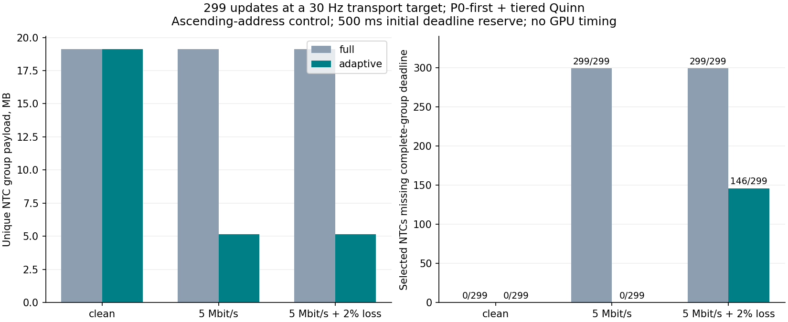
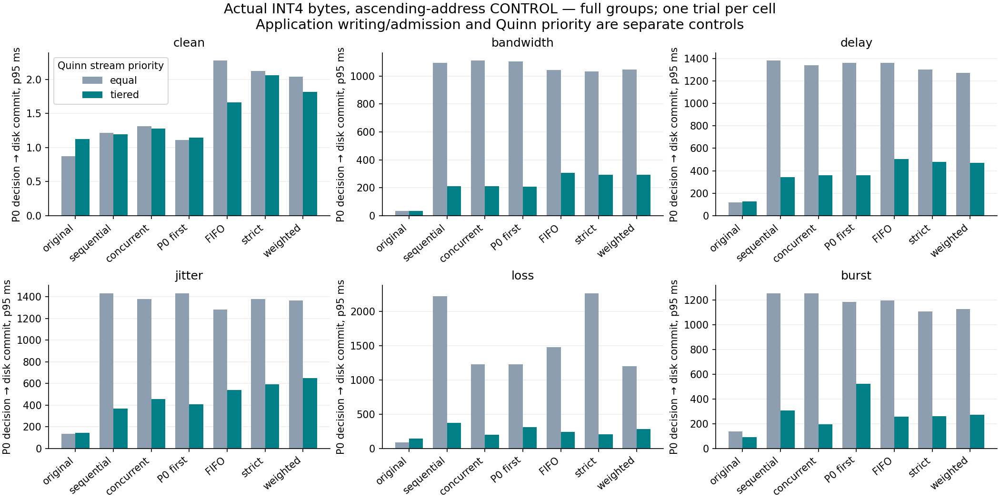

# Quinn experiments — 22 November 2026

**Status: transport controls completed; the requested saliency/stage-quality study is pending inputs.** This uses Públio's `research/quinn-priority-transport` branch (`db1d0dc`), not the earlier aioquic implementation.

The checkpoint ZIP has no `orders/NTC_*.npz` files, and the live client needs a `3DGStreamViewer/renderer.py` version absent from this repository. Both were requested by email. Until they arrive, the tests explicitly use **actual INT4-5% checkpoint bytes in ascending block-address order, with zero saliency scores**. P0–P3 here are transport labels, not Públio's visual saliency groups. Do not use these results as saliency/QoE evidence in the paper.

## What was done

- Built Quinn and tested seven application methods: original, sequential, concurrent, P0-first, FIFO, strict and weighted. Quinn stream priority is independently equal or tiered (P0=30, P1=20, P2=10, P3=0).
- Used the existing deadline selector unchanged. It chooses **1–4 cumulative groups of one INT4-5% checkpoint**, not between the seven model variants in the ZIP. Full selection is the matched control. Admission methods use 8 KiB chunks / 128 outstanding chunks.
- Added separate unique-payload and per-endpoint Quinn UDP counters. Every selected group's hash and total unique received bytes matched. UDP snapshots include QUIC/control/retransmission traffic, exclude IP/UDP headers, and stop before each local connection close. Cross-endpoint byte differences are not measured packet loss or identical-duration totals.
- Added fixed-clock image scoring plus a separate per-stage PSNR/SSIM/LPIPS table. Clock sampling holds the last actually captured display through each **end-of-slot display deadline**, includes catch-up/held ticks, and never reads future stages. VMAF uses the uniform clock sequence. This new live-capture path still needs validation with the missing viewer/inputs.

## Test conditions

188 reported runs: 168 short controls (12 updates × six profiles × seven methods × two Quinn policies × full/adaptive), 14 changing-network controls (60 updates), and six full-sequence controls (299 updates). **One trial per configuration**; loss traces are independent, so scheduler rankings are descriptive.

All run on gpu1 in a fresh private user/network namespace. A shared loopback netem queue affects data and ACK/feedback traffic; this is not two independently shaped remote links. Queue limit: 1,000 packets. Profiles: clean/unshaped; 5 Mbit/s; 40 ms + 5 Mbit/s; 40±10 ms normal jitter + 5 Mbit/s; 20 ms + random 2% loss + 5 Mbit/s; burst loss at 20 ms + 5 Mbit/s (Gilbert–Elliott 1%,25%,80%,0.1%).

Target is 30 NTC updates/s, with a 500 ms initial deadline reserve. Initial scene, Gaussian additions and GPU playback are excluded. The selector uses its configured 17 ms fallback compute estimate, not measured GPU costs. Encoded full groups need about 15.36 Mbit/s; P0 alone about 4.14 Mbit/s, before QUIC overhead.

## Main result: smaller payload helps, but does not guarantee deadlines

299 actual updates; P0-first application writes and tiered Quinn stream priority. Each received NTC must have **all selected groups** before its deadline; counts below are NTC updates, not packets, files or rendered frames.

| Network | Selection | Unique sent = received MB | Sender UDP TX MB | Late selected NTCs | Late P0 |
| --- | --- | ---: | ---: | ---: | ---: |
| clean | full | 19.133 | 19.595 | 0/299 | 0/299 |
| clean | adaptive | 19.133 | 19.595 | 0/299 | 0/299 |
| bandwidth | full | 19.133 | 19.605 | 299/299 | 271/299 |
| bandwidth | adaptive | 5.161 | 5.297 | 0/299 | 0/299 |
| loss | full | 19.133 | 20.043 | 299/299 | 297/299 |
| loss | adaptive | 5.161 | 5.423 | 146/299 | 146/299 |

At 5 Mbit/s, adaptive sent only P0 for every update: 73.0% fewer payload bytes and 0/299 selected-group deadline misses, versus 299/299 with all groups. With 2% random loss, the smallest permitted payload still missed 146/299 deadlines. Reducing load helps; the fallback P0 is not guaranteed feasible and the selector does not solve all congestion/retransmission delays. Clean runs used all four groups with no misses. These are network deadlines, **not proof of 30 rendered FPS or equal quality**.



## Scheduling and network changes



The figure holds all four groups fixed, so payload selection cannot confound the scheduler comparison. P0 p95 is sender-decision to receiver **disk commit**, not just propagation or packet transmission. The original method waits for stage acknowledgements and can make later sender decisions late; its low decision-relative latency must therefore be read alongside the absolute deadline misses, rather than used alone to rank methods. All case values, including RTT, backlog estimate, P0-first fraction and both endpoint UDP snapshots, are in [results.csv](results.csv). P0-first fractions in one-tier adaptive runs are trivially one and should not be used as priority evidence.

Changing-network runs start at 20 Mbit/s + 10 ms, switch at sender time +0.5 s to 1 Mbit/s + 40±10 ms + 2% loss, then recover at +1.5 s. In-place `tc qdisc change` preserves queued traffic and counters; all 14 runs recorded both transitions and completed. Selected-group deadline misses remained 40–45/60: recovery did not undo the earlier backlog. This is a stress test, not a sustained-quality result.

An earlier 14-case dynamic set deleted/recreated the queue. It is retained on the server as a queue-reset diagnostic and **excluded** from these tables/figures; the 14 corrected runs replace it. The 28-case three-update smoke test is also separate from the 188 reported runs. No failed or superseded run is relabelled as a corrected trial.

## Image metrics: tool check, not stage-quality results

All four metrics ran on four existing same-camera FP32/INT4 render images (initial state plus three updates), and on an identical-image control. The three non-identical INT4 images had PSNR 60.71–62.35 dB, SSIM 0.99984–0.99987 and LPIPS below 0.00005. This very short, mostly unchanged view cannot establish sequence quality, motion quality or saliency benefit. The default VMAF model reports about 97.4 even on the identical control; it is not a percentage of fidelity. `psnr` is empty for identical images (`identical=true`), representing infinite PSNR.

Actual P0→P1→P2→P3 quality and scheduler-dependent live QoE are **not measured yet**. They require the matching priority files, the complete viewer, an exact-camera FP32 reference trajectory, and live per-tick/stage captures. Stage-event scores compare each stage with that NTC's own FP32 state; uniform-clock video scores also include stale/held states. Capture readback can affect timing and must be held equal across policies.

## Reproduce / inspect

```bash
# On gpu1 only. Every run requires a fresh output directory.
source /local/users/abeigi/Q3DGStream/scripts/gpu1_env.sh
source "$HOME/.cargo/env"
cd /local/users/abeigi/Q3DGStream/.worktrees/quinn-eval/research/quic/priority_transport
export Q3DG_PARENT_NETNS=$(readlink /proc/self/ns/net)
unshare -Urn python server_matrix.py \
  --wire /local/users/abeigi/Q3DGStream/data/datasets/publio-20261119/INT4_keep05_PQAT \
  --orders /path/to/real/orders --output /local/users/abeigi/fresh-quinn-results
# To reproduce ONLY this explicitly labelled transport control, replace --orders
# with --address-control. --frames 299 --profiles clean bandwidth loss \
# --methods p0_first --priorities tiered repeats the full-sequence comparison.
```

For stage-quality scoring use `stage_timeline.py --help`; capture every tick and stage (`--capture-every 1 --save-stages`). It rejects missing per-tick captures, samples at the actual display deadline, and produces event scores separately from clock-sampled video scores. Use official LPIPS-Alex and VMAF 3.0.0; the helper supports a standalone VMAF CLI when FFmpeg lacks libvmaf.

Validation: 48 focused Python checks passed in a private namespace (including a real netem queue-counter regression); six Rust tests passed. Full-repository pytest still fails collection in the existing `progressive_299_v2/test_receiver_state_machine_v2.py` constructor. No project-wide green suite or verified new graphical capture is claimed.

Raw evidence: `/local/users/abeigi/q3dg-quinn-eval-20261122` (`matrix`, `dynamic-preserved-queue`, `long-299`, `smoke`, quality controls and test logs). Each run retains hashes/manifests, decision/group timestamps, process logs and qdisc state. Raw assets/logs stay on the server. The report is one guide, one CSV and two figures.

Metric definitions: [Quinn connection statistics](https://docs.rs/quinn/0.11.12/quinn/struct.ConnectionStats.html), [LPIPS](https://github.com/richzhang/PerceptualSimilarity), [SSIM](https://scikit-image.org/docs/stable/api/skimage.metrics.html#skimage.metrics.structural_similarity), [official VMAF tools](https://github.com/Netflix/vmaf/blob/v3.0.0/libvmaf/tools/README.md).
